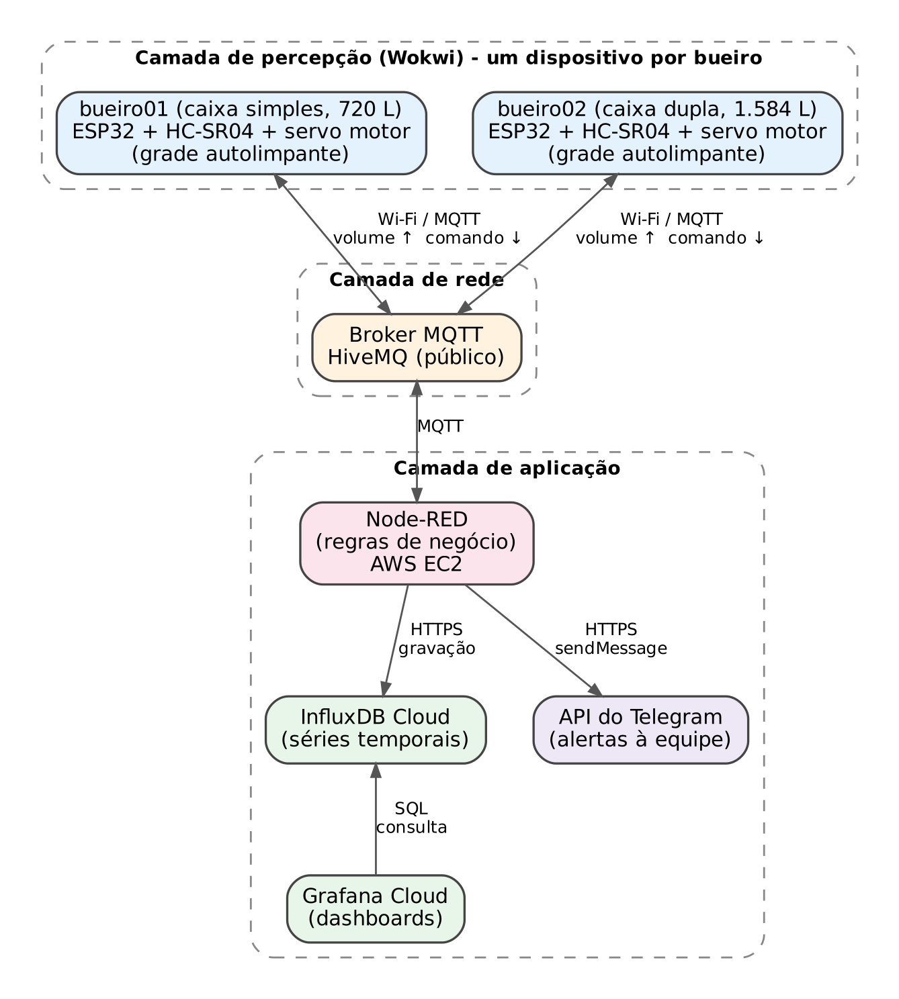
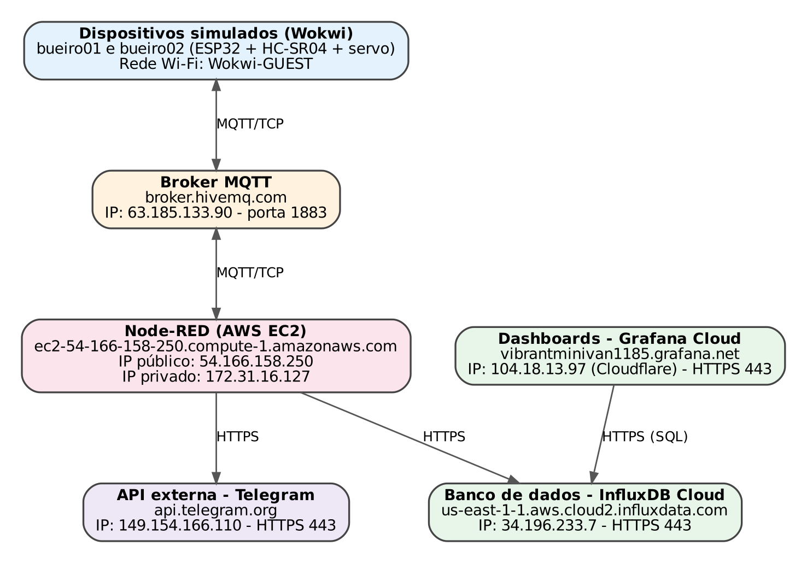
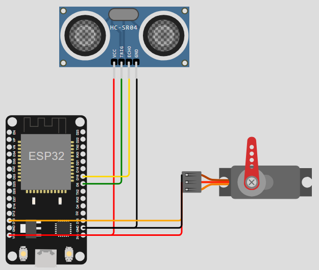
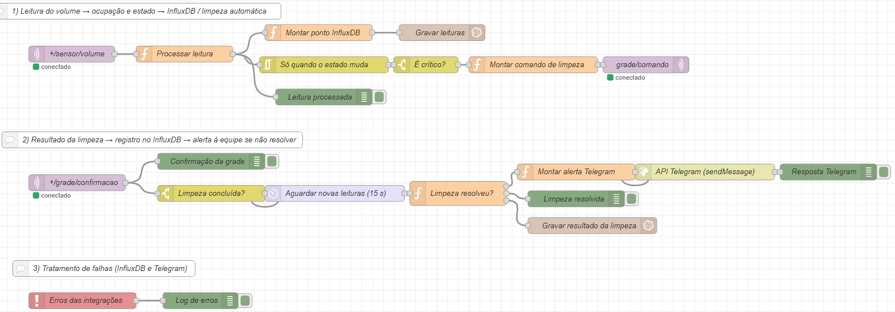
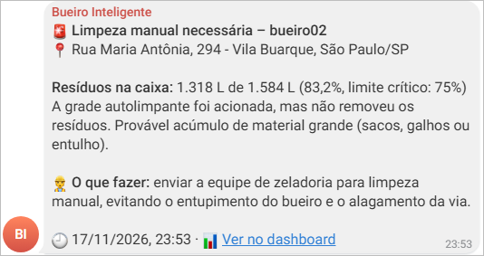
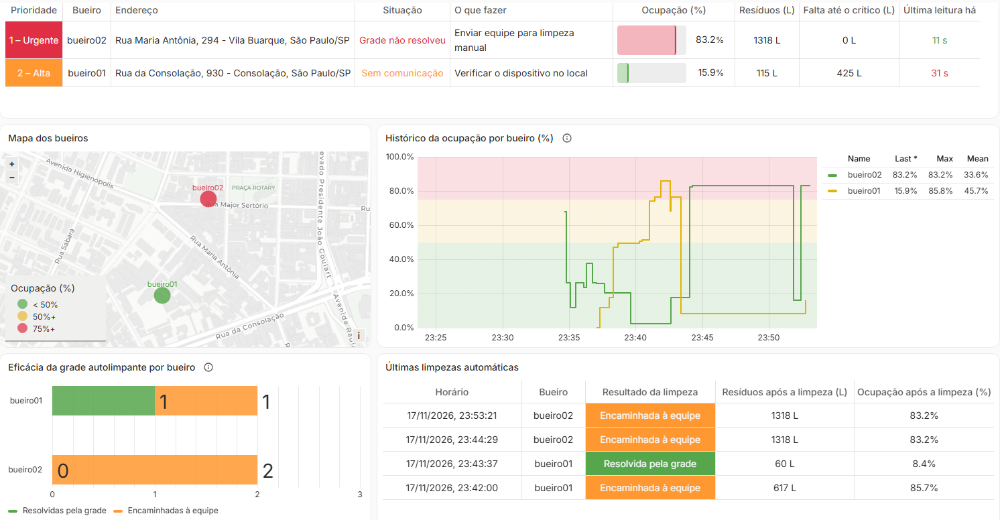

# Bueiro Inteligente: Uma Solução Automatizada para a Prevenção de Alagamentos

Projeto da disciplina **Objetos Inteligentes Conectados** — Universidade Presbiteriana Mackenzie, Faculdade de Computação e Informática.

**Integrantes:** Ana Beatriz Oliveira, Gustavo Pan, Isaac Carone e Wallace Santana

**Vídeo de demonstração:** _link do YouTube (a ser incluído)_

---

## Sumário

1. [Descrição do projeto](#1-descrição-do-projeto)
2. [Arquitetura](#2-arquitetura)
3. [Hardware, ligações e cálculo do volume](#3-hardware-ligações-e-cálculo-do-volume)
4. [Comunicação MQTT](#4-comunicação-mqtt)
5. [Regras de negócio (Node-RED)](#5-regras-de-negócio-node-red)
6. [Banco de dados e dashboard](#6-banco-de-dados-e-dashboard)
7. [Como reproduzir o projeto](#7-como-reproduzir-o-projeto)
8. [Estrutura do repositório](#8-estrutura-do-repositório)

---

## 1. Descrição do projeto

O entupimento de bocas de lobo por resíduos sólidos é uma das principais causas de alagamentos nas cidades brasileiras. Hoje, a limpeza costuma ser feita por cronograma fixo ou a partir de chamados abertos depois que o problema já apareceu.

O **Bueiro Inteligente** é um protótipo de Internet das Coisas (IoT) em que cada boca de lobo tem um dispositivo que mede continuamente o **volume de resíduos** acumulado na caixa e:

- aciona automaticamente uma **grade autolimpante** (servo motor) quando a caixa atinge o nível crítico;
- verifica se a limpeza resolveu e registra o resultado;
- envia um **alerta pelo Telegram** à equipe de manutenção **somente quando a limpeza automática não resolve**;
- grava o histórico em um **banco de dados de séries temporais em nuvem** (InfluxDB Cloud);
- apresenta as informações em um **dashboard gerencial** (Grafana Cloud).

O projeto está alinhado ao **ODS 11 (Cidades e Comunidades Sustentáveis)**, **meta 11.6** da Agenda 2030 da ONU: reduzir o impacto ambiental negativo das cidades, com atenção à gestão de resíduos municipais. Os resíduos ficam retidos e são recolhidos no próprio ponto de captação, em vez de seguirem pela rede de drenagem até córregos e rios.

### Classificação pela ocupação da caixa

| Ocupação da caixa | Estado | Ação |
|---|---|---|
| Abaixo de 50% | 🟢 Normal | — |
| De 50% a 74% | 🟡 Atenção | Acompanhar no dashboard |
| 75% ou mais | 🔴 Crítico | Limpeza automática da grade; alerta no Telegram se a ocupação continuar crítica |

---

## 2. Arquitetura

<p align="center"></p>

| Camada | Componente | Tecnologia |
|---|---|---|
| Percepção | Um dispositivo por bueiro (`bueiro01` e `bueiro02`) | ESP32 + HC-SR04 + servo motor da grade (simulados no Wokwi) |
| Rede | Broker MQTT | HiveMQ público (`broker.hivemq.com:1883`) |
| Aplicação | Regras de negócio | Node-RED em máquina virtual AWS EC2 |
| Aplicação | Banco de dados | InfluxDB Cloud Serverless |
| Aplicação | Dashboard | Grafana Cloud |
| Aplicação | API externa | Telegram Bot API |

### Topologia lógica

<p align="center"></p>

O broker MQTT, o Node-RED, o banco de dados e o gerador de dashboards estão hospedados em máquinas distintas.

---

## 3. Hardware, ligações e cálculo do volume

Cada bueiro tem **um único ESP32 DevKit V1** com o sensor e o servo, porque os dois atuam sobre a mesma caixa. Os dispositivos são simulados no [Wokwi](https://wokwi.com) e se conectam pela rede Wi-Fi simulada `Wokwi-GUEST`.

| Componente – pino | ESP32 |
|---|---|
| HC-SR04 – VCC | VIN (5 V) |
| HC-SR04 – GND | GND |
| HC-SR04 – TRIG | GPIO 5 |
| HC-SR04 – ECHO | GPIO 18 |
| Servo – sinal (PWM) | GPIO 13 |
| Servo – V+ | VIN (5 V) |
| Servo – GND | GND |

<p align="center"></p>

### Dimensões dos bueiros

As medidas são as das caixas para boca de lobo do **SINAPI** (Caixa Econômica Federal), composições 97956 (simples) e 97957 (dupla):

| Bueiro | Local | Caixa | Dimensões internas | Área da base | Capacidade |
|---|---|---|---|---|---|
| `bueiro01` | Rua da Consolação, 930 | Simples | 1,00 × 0,60 × 1,20 m | 0,60 m² | 720 L |
| `bueiro02` | Rua Maria Antônia, 294 | Dupla | 2,20 × 0,60 × 1,20 m | 1,32 m² | 1.584 L |

### Cálculo do volume

O HC-SR04 fica no topo da caixa e mede a distância `d` (cm) até a superfície dos resíduos. O ESP32 calcula:

```
altura dos resíduos (cm) = 120 − d
volume (L) = área da base (m²) × altura (cm) × 10      (limitado entre 0 e a capacidade)
```

O volume é publicado a cada 5 segundos. A **ocupação (%) = volume ÷ capacidade** é calculada no Node-RED, o que permite comparar caixas de tamanhos diferentes na mesma escala.

| Distância no Wokwi | bueiro01 | bueiro02 | Estado |
|---|---|---|---|
| 100 cm | 120 L (17%) | 264 L (17%) | Normal |
| 60 cm | 360 L (50%) | 792 L (50%) | Atenção |
| 30 cm | 540 L (75%) | 1.188 L (75%) | Crítico |

### Grade autolimpante (proposta)

Ao receber `limpar`, o servo move o raspador da grade em **duas passadas de 0° a 180°**, empurrando os resíduos para um cesto coletor, e publica `limpando` e `limpeza_concluida`.

Grades autolimpantes já existem em estruturas maiores, como a entrada de estações de bombeamento de águas pluviais. Para bocas de lobo, a solução existente é a caixa coletora passiva (Lei Municipal de São Paulo nº 16.687/2017), que precisa ser esvaziada manualmente. Por isso, a grade autolimpante é apresentada como **proposta**, adaptada à escala da boca de lobo.

### Adaptações para uma implantação real

- **Comunicação:** os bueiros ficam no subsolo e espalhados pela cidade, então o meio mais adequado seria o **LoRaWAN**. No protótipo foi usado Wi-Fi, porque o Wokwi não simula LoRaWAN.
- **Sensor:** o ambiente úmido exigiria um sensor ultrassônico à prova d'água, como o **JSN-SR04T**.
- **Atuador:** o servo representa, em escala, o mecanismo da grade; em campo seria usado um **motorredutor à prova d'água**.

---

## 4. Comunicação MQTT

Broker: `broker.hivemq.com`, porta `1883`. Padrão dos tópicos:

```
mackenzie/bueiro-inteligente/{id_bueiro}/{componente}/{informação}
```

| Tópico (após `mackenzie/bueiro-inteligente/`) | Direção | Conteúdo | QoS / Retain |
|---|---|---|---|
| `{id_bueiro}/sensor/volume` | Dispositivo → Node-RED | Volume de resíduos em litros (ex.: `540.0`) | 0 |
| `{id_bueiro}/grade/comando` | Node-RED → Dispositivo | `limpar` | 1 / sem retain |
| `{id_bueiro}/grade/confirmacao` | Dispositivo → Node-RED | `limpando` / `limpeza_concluida` | 0 |

O Node-RED assina os tópicos com o curinga `+` no lugar do identificador, então um bueiro novo não exige mudança no fluxo.

Para saber se um dispositivo parou, não é usado nenhum tópico extra no broker: o dashboard mostra, para cada bueiro, **há quanto tempo chegou a última leitura** e fica vermelho depois de 30 s sem dados.

---

## 5. Regras de negócio (Node-RED)

<p align="center"></p>

| Regra | Condição | Ação |
|---|---|---|
| R1 – Classificação | A cada leitura de volume | Calcula a ocupação (volume ÷ capacidade) e classifica em normal, atenção ou crítico |
| R2 – Registro | A cada leitura | Grava volume, capacidade, ocupação, estado e localização no InfluxDB |
| R3 – Limpeza automática | O bueiro passa para crítico | Publica **uma única vez** `limpar` no tópico de comando daquele bueiro |
| R4 – Verificação | 15 s após `limpeza_concluida` | Compara a ocupação atual com 75% e grava o resultado no InfluxDB |
| R5 – Limpeza resolvida | Ocupação abaixo de 75% | Registra `resolvida`, sem alerta |
| R6 – Limpeza não resolvida | Ocupação de 75% ou mais | Registra `nao_resolvida` e envia alerta pelo Telegram |
| R7 – Falha de integração | Erro no InfluxDB ou no Telegram | Nó `catch` registra o erro sem interromper as outras regras |

O filtro *report by exception* separa os bueiros, então o estado de um não interfere no outro.

<p align="center"></p>

---

## 6. Banco de dados e dashboard

**InfluxDB Cloud:** bucket `bueiro_inteligente`.

Measurement `leituras` (uma linha a cada leitura):

| Tipo | Nome | Descrição |
|---|---|---|
| Tag | `id_bueiro` | Identificador do bueiro |
| Field | `volume_l` | Volume de resíduos (L) |
| Field | `capacidade_l` | Capacidade da caixa (L) |
| Field | `ocupacao_pct` | Ocupação da caixa (%) |
| Field | `status` | `verde`, `amarelo` ou `vermelho` |
| Field | `latitude`, `longitude`, `endereco` | Localização do bueiro |

Measurement `limpezas` (uma linha por limpeza automática):

| Tipo | Nome | Descrição |
|---|---|---|
| Tag | `id_bueiro` | Identificador do bueiro |
| Field | `resultado` | `resolvida` ou `nao_resolvida` |
| Field | `volume_l`, `ocupacao_pct` | Situação da caixa 15 s após a limpeza |

**Grafana Cloud:** dashboard com 5 painéis, pensado para quem acompanha a operação entender na hora o que está acontecendo e o que fazer.

<p align="center"></p>

| Painel | O que mostra |
|---|---|
| O que precisa ser feito agora | Um bueiro por linha, do mais urgente ao menos urgente, com situação, **ação recomendada**, ocupação, resíduos (L), quanto falta até o crítico e a última leitura |
| Mapa dos bueiros | Onde ficam os pontos, com a cor conforme a ocupação |
| Histórico da ocupação por bueiro | A velocidade de acúmulo de cada bueiro e as quedas após as limpezas |
| Eficácia da grade autolimpante por bueiro | Quantas limpezas a grade resolveu e quantas foram encaminhadas à equipe |
| Últimas limpezas automáticas | O resultado de cada limpeza |

Prioridades da tabela principal:

| Prioridade | Situação | O que fazer |
|---|---|---|
| 1 – Urgente | Grade não resolveu | Enviar equipe para limpeza manual |
| 2 – Alta | Sem comunicação (mais de 30 s sem leitura) | Verificar o dispositivo no local |
| 3 – Média | Crítico: grade em limpeza | Aguardar a verificação automática (15 s) |
| 4 – Baixa | Atenção | Acompanhar; programar limpeza se continuar subindo |
| 5 – OK | Normal | Nenhuma ação |

O dashboard pode ser importado de [`grafana/dashboard_bueiro.json`](grafana/dashboard_bueiro.json). As consultas SQL também estão em [`grafana/consultas.sql`](grafana/consultas.sql).

---

## 7. Como reproduzir o projeto

### 7.1 Dispositivos (Wokwi)

1. Crie **dois** projetos ESP32 em [wokwi.com](https://wokwi.com).
2. No primeiro, substitua `sketch.ino`, `diagram.json` e `libraries.txt` pelos arquivos de [`dispositivos/bueiro01`](dispositivos/bueiro01).
3. No segundo, faça o mesmo com [`dispositivos/bueiro02`](dispositivos/bueiro02).
4. Rode as duas simulações ao mesmo tempo, **em janelas separadas e visíveis**. O navegador pausa simulações em abas que ficam em segundo plano.
5. Clique no HC-SR04 durante a simulação e arraste a distância para simular o acúmulo de resíduos (veja a tabela da seção 3).

### 7.2 InfluxDB Cloud

1. Crie uma conta em [cloud2.influxdata.com](https://cloud2.influxdata.com) (plano gratuito).
2. Crie o bucket **`bueiro_inteligente`**.
3. Gere dois tokens em **Load Data → API Tokens**: um de **escrita** para o Node-RED e um **somente de leitura** para o Grafana.
4. Anote a **URL** da instância e o **nome da organização**.

### 7.3 Bot do Telegram

1. No Telegram, fale com o **@BotFather**, envie `/newbot` e guarde o **token** do bot.
2. Crie um grupo, adicione o bot e envie `/start@nome_do_bot` no grupo.
3. Acesse `https://api.telegram.org/bot<TOKEN>/getUpdates` e copie o `chat.id` do grupo (número negativo).

### 7.4 Node-RED

1. Instale o Node-RED (ex.: em uma VM AWS EC2) e, em **Gerenciar paleta**, instale `node-red-contrib-influxdb`.
2. Importe o arquivo [`node-red/flows.json`](node-red/flows.json) (**☰ → Importar**).
3. Edite o servidor **InfluxDB Cloud** (URL e token de escrita) e, nos nós **Gravar leituras** e **Gravar resultado da limpeza**, troque `SUA_ORGANIZACAO` pelo nome da sua organização.
4. Dê dois cliques na aba **Bueiro Inteligente** e preencha as variáveis de ambiente `TELEGRAM_BOT_TOKEN`, `TELEGRAM_CHAT_ID` e `LINK_DASHBOARD` (opcional).
5. Clique em **Implementar**.

### 7.5 Grafana Cloud

1. Crie uma stack gratuita em [grafana.com](https://grafana.com).
2. Em **Connections → Data sources**, adicione um **InfluxDB** com **Query language: SQL**, a URL da instância, **Database:** `bueiro_inteligente` e o token somente de leitura.
3. Em **Dashboards → New → Import**, envie [`grafana/dashboard_bueiro.json`](grafana/dashboard_bueiro.json) e escolha o data source criado.

> **Segurança:** nenhum token ou chave de API está neste repositório. Os valores devem ser configurados nas credenciais e nas variáveis de ambiente do Node-RED e do Grafana.

---

## 8. Estrutura do repositório

```
├── README.md
├── dispositivos/
│   ├── bueiro01/          # ESP32 + HC-SR04 + servo (caixa simples, 720 L)
│   │   ├── sketch.ino
│   │   ├── diagram.json
│   │   └── libraries.txt
│   └── bueiro02/          # ESP32 + HC-SR04 + servo (caixa dupla, 1.584 L)
│       ├── sketch.ino
│       ├── diagram.json
│       └── libraries.txt
├── node-red/
│   └── flows.json         # Fluxo completo (sem tokens)
├── grafana/
│   ├── dashboard_bueiro.json  # Dashboard para importar
│   └── consultas.sql      # Consultas SQL dos painéis
└── docs/
    └── imagens/           # Diagramas e capturas de tela
```
